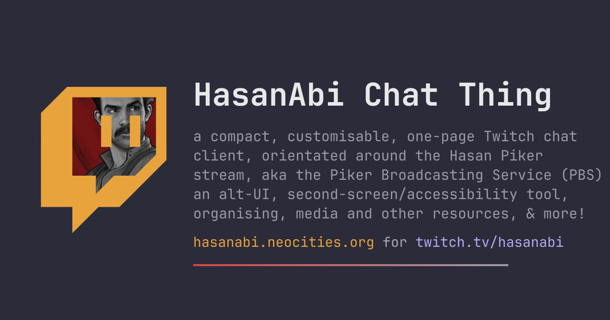

# HasanAbi Chat Thing

A compact, customizable Twitch chat page orientated around the
[HasanAbi](https://www.twitch.tv/hasanabi) stream
([Hasan Piker](https://en.wikipedia.org/wiki/Hasan_Piker)'s
channel, aka the Piker Broadcasting Service - a play on the US
[PBS](https://en.wikipedia.org/wiki/PBS))

It's a one page, alt-UX, second-screen/accessibility tool that's super customisable, with channel related resource links!

Live at
<https://hasanabi.neocities.org/> (on
[Neocities](https://neocities.org/))

About at
<https://hasanabi.neocities.org/about/>.

In wordier terms: it's the stream's chat, liberated from twitch.tv.
A single self-contained page, running on a static host, that:

- renders the chat log itself - timestamps, badges, replies, notice
  rows and all
- survives suspends, discards and reloads - backfilling whatever
  was missed rather than opening on a gap
- draws a live messages-per-second rate graph in the header
- understands every major emote ecosystem - Twitch natives plus
  [7TV](https://7tv.app/), [BetterTTV](https://betterttv.com/) and
  [FrankerFaceZ](https://www.frankerfacez.com/)
- after an optional [Twitch OAuth](https://dev.twitch.tv/docs/authentication/)
  login, replies, `/me`s and chat-history walkbacks work like a real
  [IRC](https://en.wikipedia.org/wiki/IRC) client

Beyond chat, the page doubles as a curated hub - the `?` help/conf
popup also carries:

- media - clips, news outlets, youtube channels and sister twitch
  streams
- left / libre - organising and political links, free-culture
  resources
- authors - era-grouped reading lists

Any other Twitch channel can be pointed at with `?channel=login`,
and a comma list (`?channel=a,b,c`, up to 6) merges several rooms
into one log:

- the first channel stays focused - title, stream status, video,
  chat target and storage all follow it
- each row carries a `#chan` chip that refocuses on click

Technically the project comes in two parts: the frontend
([hasanabi.neocities.org](https://github.com/mxmilkiib/hasanabi.neocities.org),
this repo - a single `index.html`) and the backend chat relay
([twitch-chat-relay](https://github.com/mxmilkiib/twitch-chat-relay),
also a single `index.html`, hosted on GitHub Pages).

## Why two parts?

Neocities serves pages with a strict
[Content Security Policy](https://developer.mozilla.org/en-US/docs/Web/HTTP/Guides/CSP):

    connect-src 'self' data: blob:

That blocks the
[WebSocket](https://developer.mozilla.org/en-US/docs/Web/API/WebSocket)
connection to [Twitch IRC](https://dev.twitch.tv/docs/irc/)
(`irc-ws.chat.twitch.tv`), so the official Twitch embed,
[jChat](https://www.giambaj.it/twitch/jchat/), and any direct socket
are all impossible. `frame-src` is unrestricted though, so the page
embeds a hidden iframe relay hosted on [GitHub
Pages](https://pages.github.com/) (which sends no CSP) and talks to
it with
[`postMessage`](https://developer.mozilla.org/en-US/docs/Web/API/Window/postMessage).

The split is therefore by network privilege, not by concern: the frontend
owns all presentation and state, while the relay owns every outbound
connection. Because the relay learns its channels from the `join` message
rather than anything hardcoded, it is channel-agnostic - any page on any
CSP-locked host can embed the same iframe for any Twitch channel. The
hasanabi specifics all live in this file; the relay could just as well
serve a completely different channel page.

## The Backend - `twitch-chat-relay` (GitHub Pages)

Repo: <https://github.com/mxmilkiib/twitch-chat-relay> - also a single
`index.html`, loaded as a hidden iframe from
`https://mxmilkiib.github.io/twitch-chat-relay/`.

Channel-agnostic by design: it takes the target channel from the embedder's
`join` message and derives everything else from it. It does the network work
the CSP forbids on Neocities:

- Connects to Twitch IRC over WebSocket as an anonymous `justinfan`
  user (Twitch's convention for read-only access without an
  account), requests `tags` + `commands` capabilities, handles
  PING/RECONNECT, and rejoins with exponential backoff.
- Polls [DecAPI](https://decapi.me) every 60s for uptime, viewer count
  and title (no auth needed).
- Fetches [ivr.fi](https://api.ivr.fi) user info (`lastBroadcast`),
  the [7TV](https://7tv.app/) / [BTTV](https://betterttv.com/) /
  [FFZ](https://www.frankerfacez.com/) emote sets, and the latest
  VOD via Twitch's public GraphQL endpoint for exact stream
  start/end times.

### Message protocol

Parent → relay:

| message | purpose |
|---|---|
| `{type: 'join', channels[]}` | set the channels to watch (a bare `channel` string still works); repeats diff JOIN/PART |
| `{type: 'backfill'}` | ask for the recent-messages backlog (every joined channel, merged by timestamp) |
| `{type: 'auth', token}` | log in (or `token: null` to log out) |
| `{type: 'send', channel, text, replyTo}` | post a chat message once authenticated; `replyTo` attaches a `reply-parent-msg-id` tag |
| `{type: 'tweet', id}` | fetch an X/Twitter preview via [fxtwitter](https://github.com/FixTweet/FxTwitter) |
| `{type: 'twsets', ids}` | fetch Twitch emote-set metadata via [ivr.fi](https://api.ivr.fi) |

Relay → parent:

- `{type: 'status', state}` - connecting / connected / reconnecting
- `{type: 'lines', lines[]}` - raw IRC lines, live or backfilled
- `backfill` - on request, the relay fetches the backlog from
  [recent-messages.robotty.de](https://recent-messages.robotty.de/)
  (the same service [Chatterino](https://chatterino.com/) uses) and
  forwards it as `lines`; the page skips already-rendered msg ids
- `{type: 'stream', channel, uptime, viewers, title}` - decapi poll
  result, per joined channel
- `{type: 'emotes', channel, emotes, emoteSrc, zeroWidth, badges,
  lastBroadcast, lastVod, emoteUse, emoteAnim}` - per-channel emote map +
  sources + badge sets + stream history + per-emote channel usage counts
  ([StreamElements](https://streamelements.com/) chatstats) +
  animated-emote names, refetched every
  10 minutes (global sets are fetched once per cycle and merged in)
- `{type: 'nitter', host}` - fastest healthy
  [nitter](https://github.com/zedeus/nitter) instance from
  [status.d420.de](https://status.d420.de/), rechecked every
  15 minutes
- `{type: 'wscause', code, reason}` - why the Twitch socket last closed,
  sent with each `reconnecting` status; the page shows it in the header
- `{type: 'repo', stars, created, pushed}` - GitHub metadata for the
  source row of the help popup
- `{type: 'auth', login}` (or `{type: 'auth', error}`) - after `auth`, the
  relay validates the token at
  [id.twitch.tv](https://dev.twitch.tv/docs/authentication/),
  reconnects the socket with
  the user's credentials, and reports the resolved login
- `{type: 'tweet', id, tweet}` - preview data for a tweet link
- `{type: 'twsets', key, sets}` - the emote-set metadata reply (`key`
  echoes the asked `ids`)

## The Frontend - `index.html` (this repo, on Neocities)

Everything runs client-side in one file - no build step, no framework,
no dependencies beyond CDN-hosted fonts.

### Chat log

- Rows - timestamps, linked names, real badge icons (mod, VIP, sub
  flair, bits, founder…) with text chips as fallback, and `[sub N]` /
  `[bits]` / `[first]` chips.
- Replies - the full original is quoted in a ruled block above the
  line; click it to jump back to the source row.
- `/me` actions, `!command` and `#tag` lines render in italics (names,
  chips and timestamps stay upright).
- USERNOTICE subs/raids/gifts become dim italic notice rows;
  CLEARCHAT/NOTICE events show timeouts, bans and channel notices. A
  room-wide `/clear` wipes rendered rows, while a timeout or ban
  ghosts that user's rows in place (struck-through but readable,
  including own echoes); a timeout or ban on the logged-in user locks
  the chat input with a live countdown until it expires.
- Name colours - the chatter's own Twitch colour when set, a
  hash-derived palette colour otherwise; either way the luminance is
  nudged so names stay legible on the active theme (the console theme
  ignores chatter colours for its phosphor-green palette).
- Gap notices - stretches the page wasn't watching (hidden tab,
  suspended timers, page closed, socket dropped) get a
  `· Nm gap · cause · start → end` row so lost context stays visible.
- Whispers - `WHISPER` lines render in their own floating pane beside
  the log (needs a login carrying whisper scopes); an unread count
  badges a `✉` header chip that opens it, and `/w name text` replies
  through `#jtv` like other clients.
- Permalinks - clicking a row's timestamp copies a `?mid=` link;
  opening it scrolls to and flashes the row.

### Emotes

- Native Twitch `emotes` tags render as animated v2 images (static
  fallback); cheermotes on bit messages; 7TV, BTTV and FFZ sets
  including animated FFZ (the name → CDN URL map comes from the relay).
- Zero-width 7TV emotes stack onto the previous one.
- Emote-only rows render large (mode configurable: inline / pinned
  right / normal).
- Hovering an emote - in a row or in the picker - pops a card with the
  art at the provider's largest size plus the code and its source set
  (emoji cells show the glyph with their search keywords).

### Emote picker

- `☻`, in the bottom left corner, opens a
  [Chatterino](https://chatterino.com/)-style grid: 7TV / BTTV /
  FFZ / Twitch / emoji
  (~600 glyphs) sections with search, a `recent` row of the last 24
  used, per-source tab toggles, still/animated filters, and a `mix`
  toggle that merges every enabled source into one flat grid. Cells
  dedupe across providers up to case - 7tv's `glorp` and bttv's `Glorp`
  collapse to the first source scanned - and emoji always trail the
  merged grid.
- Ordering is alphabetical or by usage - most recently used in chat
  first (StreamElements chatstats via the relay seed lifetime counts
  for tie-breaks; live session use updates both and persists across
  reloads). In mix mode anything used in the last minute pins to the
  very top; sectioned mode keeps recents atop their own section.
- In usage mode, dashed `2m`/`5m`/`10m`/`20m`/`30m`/`40m`/`50m`/`60m`
  cells mark where emotes were last used over that long ago - dim until
  recording has actually covered that span, then bold and
  accent-bordered - plus a solid accent square at the point recording
  began (everything below it was never seen). A square an emote crossed
  this session turns gold, and the `▤`/`▥` button cycles three row
  modes: flowing, each era on its own row, or inline with each visual
  row ending at its last square.
- Reshuffles animate emotes sliding to their new spots; a just-used
  emote flashes behind its cell, each use stepping the flash ~24° round
  the hue wheel so consecutive uses read as a spectral walk.
- `Aa` overlays each emote's code, `½x`/`¾x`/`1x`/`1⅓x`/`1½x`/`1⅔x`/`2x`
  buttons size the grid, `hold` freezes usage reshuffles while the
  pointer is over the grid (`hold+` also pauses animated cells), and a
  pause chip swaps cells for their still frames.
- The box resizes from its left and top edges (shading on hover) and
  drags by a dotted grip strip (both persist). It opens by default -
  only a deliberate close keeps it down next visit - and a `📌` pin
  floats it free of the chat bar. All display options - names,
  size, sort, age rows,
  mix, hold, tabs, anim filter, geometry - ride the settings bundle,
  theme slots and copied URLs.
- Clicking inserts at the caret; `Esc` peels the topmost layer -
  picker first, then the help panel.

### Sending & the input bar

- Optional Twitch login (the Twitch button, implicit OAuth - no secret
  ships in the page) enables a chat input bar. Chat-scoped tokens live
  in localStorage until logout.
- A `➤` button sends for pointer/voice-only users; typing a character
  anywhere jumps into the box.
- `/me` is wrapped as a CTCP ACTION so it renders as a proper action
  line; slash commands pass through as Twitch reads them (`/timeout`,
  `/ban`, `/announce`, `/raid`…), dropping any pending reply tag.
- Hovering a row shows `↩` to reply - the pending-reply bar shows the
  target and cancels on `Esc`; the send carries `reply-parent-msg-id`.
  Twitch prepends the `@login` itself, so only the local echo spells
  it out.
- Local echoes render instantly and are adopted in place when the real
  line replays through backfill; they persist across reloads so a
  racing backlog can't eat a just-sent line.
- A plain click on a chatter's name types `@name ` at the input caret
  (modifier-clicks still open the profile).
- `@` at a word boundary opens a narrowing pick of the joined channels
  plus recently seen nicks (freshest first, each in its chat colour) - tab/⇧tab walks it, enter
  or a click fills the name. `:word`, or any bare word of 3+ letters
  followed by tab, completes emote codes the same way, with a small
  preview beside each candidate.
- The box is a growing textarea - a wrapping draft gains a line at a
  time up to five before scrolling; ⇧`enter` writes a newline, plain
  `enter` sends.
- A character count sits beside the box - amber past ~200 chars (the
  guessed [fossabot](https://fossabot.com/) long-message cutoff; the
  real filter isn't public)
  and red near Twitch's 500 cap, with the box border tinting to match.
- Readline-style history: `↑`/`↓` in the input walk sent messages,
  stashing the draft on the first `↑` and restoring it once `↓` walks
  back past the newest entry; `↓` on a non-empty draft parks it as a
  navigable slot under whatever is sent next. The ring (100 deep,
  per channel) persists in `localStorage`, so `↑` after a reload still
  reaches older sends like an IRC client.
- Channel rules apply server-side - slow mode counts down in the input
  after each send (mods/VIPs exempt), and rejections arrive as
  ordinary `[notice]` rows.

### Header & graph

- Stream status dot (live / idle-gold / offline); the SVG favicon is
  rebuilt in the dot's computed colour so the tab icon tracks stream
  state per theme.
- Uptime, viewers, title on hover; offline shows last-run info;
  ROOMSTATE chat modes (slow, follow age, emote-only, subs-only, r9k).
- The `–` button cycles three sizes: full → reduced (option buttons
  hide; `?`, `–` and the `▶` stream-play stay pinned at the right edge
  at their full size) → minimised, a 10px strip carrying just `–` that
  restores on click.
- Messages-per-second sparkline with 10s/minute ticks and red-on-halo
  glorp/F bursts (the channel-cat emote and its
  [F](https://knowyourmeme.com/memes/press-f-to-pay-respects)
  chorus); dim bands shade spans the page wasn't watching
  (suspended timers, reloads) instead of drawing them flat. Hovering
  reads the sample under the cursor - msgs/s (or the band's cause on
  a gap), glorp count, wall-clock time. It flexes to fill whatever
  header space is free (the whole bar in reduced mode), re-rasterises
  to match its box so it stays sharp through resizes, and persists
  across reloads.

### Display options

- Colour style palettes (brightness-ordered, each with a designed
  shade stop) plus a separate 9-stop shade axis (white → black, or
  system-following auto); the `◐` cycle swaps hue family alone while
  picking a chip also applies its shade.
- Typography - font picker (incl. dyslexia-friendly faces), size,
  weight, line height, graduated text shadow.
- Rows - zebra striping (highlighted rows keep their own colour), row
  separator shades, five timestamp modes (off / no seconds / seconds /
  12-hour / 12-hour + seconds), five sub-chip modes (right / compact
  `[NN]` / before badges / compact-left / hidden; a dim " -- " marks
  chatters Twitch reported no month count for, skipped on the bots).
- Split columns - six modes: two page-flip columns (three in
  landscape), each holding one page that hands its overflow to the
  next while retired pages archive into the log; then three rail
  layouts alongside two chat columns - stream + emote picker + stats,
  stream + picker, and picker alone (the video floats over the chat on
  demand there). In the first, the seam between the picker and the
  stats pane drags to share the column, and a squeezed stats pane
  sheds its lists before its rate graph.
- `live?` in the media tab pings every linked Twitch channel
  through the relay; live links gain a green dot and an
  uptime/viewers/title tooltip, offline ones grey out.
- Stream video overlay - draggable, resizable, loads only when
  enabled; in the rail modes it docks, floats or turns off (an 'off'
  revives docked on rail re-entry), and it pauses while hidden so no
  audio leaks; its glyph goes green while the stream is live, red when a
  stopped player exists and the stream is not.
- Tabbed help panel (help/conf · stats · media · left · libre ·
  authors) with its own width and font-size controls; resizes from its
  edges (the affected surfaces shading on hover) and rests in a 9-spot
  dock until dragged.
- Everything persists in `localStorage`; every option answers to
  click, shift+click (reverse) and the scroll wheel. In the popup the
  style and preset links render as live swatches - background, text
  colour and, for presets, the bundled font.
- Three **theme slots** under the copy-settings-URL button stash whole
  option bundles - click recalls a filled slot (or stores the current
  options into an empty one), ⇧click/right-click overwrites; they sync
  across open tabs and clear with `reset all settings`.

### Formatting extras

- Mention highlighting - your own login joins the keyword set when
  logged in; a block-words field does the inverse, hiding any matching
  line outright. `@name` mention text and reply-parent nicks render in
  the mentioned chatter's own nick colour (their real Twitch colour
  once seen, the palette hash otherwise).
- GLORP/F red rows, channel-point tints, fossabot/blammobot name
  shimmer (and the urls in their posts), game-line styling, braille
  art restacking.
- Image/GIF/[Giphy](https://giphy.com/) embeds pinned right;
  X/Twitter preview cards via
  [fxtwitter](https://github.com/FixTweet/FxTwitter) rendered below
  the whole message (text skipped when a bot
  like fossabot already pasted it, video thumbs playable inline;
  profile links fall back to [Bird.makeup](https://bird.makeup/)
  when nitter is down).
- `[notice]` labels on event rows get a cycling rainbow wash.
- Mentions landing while the page is unfocused queue on a clickable
  `@N` chip in the header - click to jump to each, ⇧click clears; a
  `♪` toggle in help/conf adds a soft ping for those lines.
- `🔗` links view filters the log to rows carrying a URL and shows
  each link only once (session-only, not saved); `✂` clean urls
  rewrites link text without the `https://`, `www.` or a trailing
  `/index.htm`. Share-tracking parameters (`utm_*`, ig's `stkn`,
  yt's `si`, x's `s`/`t` and friends) are stripped from the target
  itself on render, so the clean form is also what stats tallies and
  dedupe folds on.
- Find bar - `ctrl+f` (a second tap hands off to the browser's own find),
  `/` or the `⌕` button floats a search over the
  rendered scrollback: bare words match text, `user:login` the
  chatter, `kind:notice|mod|gap|action|emote|mention|kw|deleted|sub`
  the row type. `enter`/`⇧enter` step between matches with a counter,
  `only` collapses non-matching rows, and `archive` searches the local
  [IndexedDB](https://developer.mozilla.org/en-US/docs/Web/API/IndexedDB_API)
  store - every rendered row indexes flat fields per channel
  (30-day retention, ~50MB cap) so search reaches past scrollback's
  edge; hits that still render jump to the row.
- User hiding - a comma list of logins in help/conf hides their
  rows in one of three modes: `vanish` drops them, `stub` folds them
  into a running count line, `ghost` strikes them dim like deleted
  rows; persisted across visits.
- User card - clicking a nick or @mention pins an inspector: colour,
  pronouns, first-seen, session message count, recent lines, and
  profile / @mention / hide buttons. Where one's own USERSTATE flags
  mod, broadcaster or VIP privileges the card also offers
  `timeout 10m`, `ban` and `delete msg`, each a click-twice confirm
  sent through the relay as IRC commands. `⇧`/`⌃`/`⌘`-click still
  opens the Twitch profile.
- Hover previews - external links, nicks and @mentions pop a card:
  title and description, where a shortened link really lands, a
  playable video for instagram reels (resolved through
  [kkclip](https://www.kkclip.com/)), x/twitter status cards through
  fxtwitter anywhere outside chat
  rows, and for Twitch profiles the live state, followers, chat modes
  and pronouns when the chatter set them on
  [alejo.io](https://pronouns.alejo.io/). Lookups run
  through the [linkpeek Cloudflare
  worker](https://github.com/mxmilkiib/twitch-chat-relay/blob/main/linkpeek-worker.js);
  a help/conf option scales
  the card down to text or off, and it's skipped on touch screens.

### Keyboard & accessibility

- A hidden live region announces new lines to screen readers (history
  replays skipped); the columns are `feed` landmarks and the picker is
  a labelled `dialog`.
- With the chat bar up, `↑`/`↓` select a row (accent outline),
  `r`/`enter` replies to it, `Esc` drops the pick, and typing jumps
  into the input.
- `Esc` peels layers in order - row pick, emote picker, help panel.
- Pause-on-hover option holds the scroll while a row is hovered.
- Scrolling follows new messages only while at the bottom; scrolling
  up releases it and shows a jump-to-latest button with a count of
  rows below the fold (one per column in split mode).
- `prefers-reduced-motion` honoured on shimmers, pulses and marker
  animations.

### Persistence, sync & channels

- Scrollback - the help/conf panel offers limits from 250 to 100,000
  rows (5,000 by default). Larger limits use more browser memory and
  may slow long-running tabs; at most the newest 1,000 rows (including
  gap notices) survive reloads via
  [`localStorage`](https://developer.mozilla.org/en-US/docs/Web/API/Window/localStorage).
- Stream run history, graph samples, emote-use stats, per-day/hour
  stats buckets, option bundles and picker geometry persist too.
- Multi-tab - option changes and login/logout propagate to other open
  copies through `storage` events; sent-message echoes broadcast over
  a [`BroadcastChannel`](https://developer.mozilla.org/en-US/docs/Web/API/BroadcastChannel)
  so every copy renders them at once.
- `?channel=login` points chat, stream embed and status at another
  streamer for the visit; history, graph and tab-sync keys get a
  per-channel suffix so streams don't bleed into each other, and the
  OAuth round-trip carries the channel in `state`. The media tab's
  twitch streams row links each streamer with a `*` that switches to
  them.
- [PWA](https://developer.mozilla.org/en-US/docs/Web/Progressive_web_apps)
  - installable (manifest + pass-through service worker); an
  installed standalone window survives backgrounding better than a
  tab. On cold join, wake or reconnect the page asks the relay for
  missed lines via recent-messages.robotty.de, so the log backfills
  rather than opening empty or staying truncated.

### Help popup & resources

- Six tabs - help/conf, stats (a session cell with chatter/message/
  badge counts and peak viewers; a channel scope picker when several
  are joined; top chatters and badges over all-time/24h/12h/6h/3h/1h
  windows folded from per-day and per-hour buckets; top emotes
  by channel usage, the same buckets, or StreamElements lifetime
  counts; top links with favicons, fetched page titles and tweet
  previews; the rate graph's loudest bursts (4+ msgs/s) and glorp peaks linked to
  that day's [supa chat](https://tv.supa.sh/) log; and a storage cell
  sizing the app's own
  footprint - localStorage keys, archive row count, origin estimate),
  media (re Hasan, clips, news, yt channels, twitch streams,
  community), left (usa pol, [dsa](https://www.dsausa.org/) chapters,
  left parties, orgs,
  organising, conduct, [dual power](https://en.wikipedia.org/wiki/Dual_power),
  [mutual aid](https://en.wikipedia.org/wiki/Mutual_aid_(organization_theory)),
  activism, justice),
  libre (free software, free culture, open hardware, open social,
  open net, open knowledge, open gov, digital rights,
  [osint](https://en.wikipedia.org/wiki/Open-source_intelligence)),
  and authors (era-grouped reading lists) - laid out in link
  columns whose count is capped by the popup's own width via
  container queries.
- Split rule between left/libre and authors: people and their texts
  live in authors (`data-w` the work, `data-g` the tagline's source);
  left/libre links concepts, organisations and tools. Where a topic
  wants its texts in context they sit under a **reading** row, and the
  author's name is an `a.au[data-au]` cite that hops to the authors tab
  and flashes the entry - so a text only appears in left/libre when its
  author has an entry.
- The popup resizes from its edges and offers widths from 480 to
  1600px.

### URL options

Query params apply a configuration on top of (and into) the saved one,
e.g. `?split&theme=dark&size=18&font=inter`. Booleans take `=0` to
force off.

| key | values | effect |
|---|---|---|
| `split` | `1`–`6` | column modes: 1 single · 2/3 page-flip (3 on landscape) · 4 rail of video·emotes·stats · 5 rail of video·emotes · 6 emotes rail (video floats on demand) |
| `min` | `1` / `graph` | minimised strip, or reduced header with the rate graph across the bar |
| `style` | a theme name | palette (a bare `style` lands on its designed shade stop) |
| `shade` | `0`–`8`, `auto` | shade axis; `auto` follows the system |
| `font` | a font key | chat font family |
| `size` | `7`–`32` | chat font px |
| `lh` | a line-height key | row line height |
| `wght` | `300`–`700` | font weight |
| `ls` | `-0.08`–`0.12` em | letter spacing (tracking) |
| `lw` | `300`–`700` | weight of entry links across the `?` popup - media, left/libre, authors, stats |
| `hfs` | px / `auto` | header font size (unset follows chat) |
| `hpfs` | px / `-1`…`-3` | help popup font size (negatives follow the chat font that many steps down) |
| `hpw` | `480`–`1600` | help popup width |
| `pause` | flag | hold the scroll while hovering a row |
| `scrollback` | `250`…`100000` | row cap |
| `rev` | flag | reverse flow - new messages cascade down from the top |
| `bartop` | flag | dock the chat input under the header instead of at the bottom |
| `channel` | a twitch login | point the whole page at another channel |
| `zebra` | `0`–`4` / flag | zebra stripe contrast (0=off, 1=faint, 2=mild, 3=strong, 4=heavy; a bare flag = mild) |
| `lines` | `0`–`3` | row separator shades |
| `times` | `nosec`/`24h` / `24hsec` / `12h` / `12hsec` / `0` | timestamp mode |
| `shadow` | `0`–`2` | text shadow level |
| `video` | flag / `dock` / `float` / `off` | stream video overlay; rail placement in mode 4, shown/hidden in 5–6 |
| `sub` | `right`/`num-right`/`left`/`num-left`/`hidden` | sub-chip mode |
| `eonly` | `inline`/`right`/`off` | emote-only row mode |
| `help` | `off`/`panel` | help popup visibility (old `labels`/`both` urls still set the labels flag) |
| `lbls` | flag | header button labels shown beside each header control - independent of the `?` cycle |
| `htab` | `config`/`media`/`left`/`authors`/`stats` | selected `?` popup tab; alone it also opens the panel (`resources` and `liberatory` still resolve to `media`/`left`) |
| `kw` | comma list | keyword highlights (green edge) |
| `bw` | comma list | block words - matching lines hidden |
| `ping` | flag | mention ping sound |
| `clean` | flag | cleaned link text |
| `gifsafe` | flag | giphy pg-13 safe-search |
| `notify` | flag | background notifications (asks permission on first load) |
| `self` | flag | accent edge on one's own messages |
| `peek` | `0`–`3` | link-hover cards: off / text / +image / +icons |
| `yt` | `0` | youtube link embeds off |
| `lkico` | `0` | link favicons off |
| `pn` | `0` | pronoun lookups on profile cards off |
| `cmodes` | `0` | active chat-mode display off (chips and status-line mode text) |
| `anim` | `0`–`3` | nick shimmer: off / super slow / slow / on |
| `rbw` | `1`–`4` | @hasanabi rainbow: wave / hue cycle / pulse / flicker |
| `epnames` | `1` | picker: emote names on cells |
| `epzoom` | `sm`/`q`/`th`/`hf`/`tw`/`big` | picker cell size (½x / ¾x / 1⅓x / 1½x / 1⅔x / 2x) |
| `epsort` | `az`/`useseen` | picker sort (default usage; `useseen` = usage order, hiding never-used emotes) |
| `epage` | `0`–`2` | picker age-square rows: flowing / era rows / rows end at the last square |
| `epmix` | `1` | picker merged provider grid |
| `ephold` | `0`–`2` | picker reshuffle hold (2 = hold+, pauses animated cells) |
| `eptabs` | comma list | picker sources: `7tv,bttv,ffz,twitch,emoji` |
| `epanim` | `anim`,`animf`,`still` | picker animation filter (`animf` = animated shown as stills) |
| `epgeo` | `WxH[,L,T]` | picker box size (and float position, pinned) |
| `epopen` | flag | picker open state - the popup opens or stays closed |
| `overlay` | flag | [OBS](https://obsproject.com/) browser-source mode: transparent page, live rows only |
| `mid` | a message id | scroll to and flash that row on load (set by timestamp clicks) |
| `hw` | comma list | hide these logins' rows |
| `hwm` | `vanish`/`stub`/`ghost` | how hidden users' rows render |

`theme` names a preset bundle of all display options:

- `default`, `compact`, `print`, `cosy`, `cinema`, `phosphor`,
  `dyslexic`, `midnight`, `solar`, `minimal`, `retro`, `irc`,
  `gohu`, `heather`, `nightshade`, `ft`, `ftdark`, `twitch`

A style name like `theme=dark`
still selects just the palette, which is
also what the retired preset names `paper`, `mirc` and `console` now
resolve to. Presets never share a name with a style. Each preset also
pins the header button labels: `default` keeps them on and every other
preset runs the bare header (the `?` popup is unaffected either way).

The copy-settings button builds this url for the current options; a set
theme rides it as `?theme=name` and options still matching the preset
drop their param, so only drifted settings spell out.

### Performance

- Incoming lines queue and flush once per animation frame.
- The log defaults to 5,000 rows, with higher optional caps up to
  100,000; background message queues and saved reload history stay
  bounded at 1,000 rows.

## vs. other Twitch chat clients

Where this sits relative to the usual suspects:

| | this page | Twitch site | Twitch embed | [Chatterino](https://chatterino.com/) | [Chatty](https://chatty.github.io/) | [jChat](https://www.giambaj.it/twitch/jchat/) | [DankChat](https://github.com/flex3r/DankChat) | [Chatsen](https://github.com/chatsen/chatsen) |
|---|---|---|---|---|---|---|---|---|
| form factor | one web page | web chat panel | iframe/popout | desktop app | desktop app (Java) | web overlay | Android app | iOS/Android app |
| install / build | none, static file | none | none | app install | JRE | none | Play / F-Droid | app stores |
| runs on strict-CSP static hosts | ✅ (relay iframe) | n/a | embed-domain rules | n/a | n/a | partial | n/a | n/a |
| send chat (login) | ✅ implicit OAuth | ✅ | ✅ | ✅ | ✅ | ❌ | ✅ (+whispers) | ✅ |
| replies | quoted block, jump-back | ✅ threads | collapsed thread | ✅ | ✅ | ❌ | ✅ | ✅ |
| polls / predictions / points | ❌ | ✅ | ❌ | partial | ❌ | ❌ | ✅ | partial |
| 7TV / BTTV / FFZ | ✅ animated, zero-width stacks | ❌ (extensions) | native only | ✅ | ✅ | partial | ✅ | ✅ |
| backfill after suspend/resume | ✅ (robotty) | recent only | ❌ | ✅ | ❌ | ❌ | history search | ❌ |
| msgs/sec graph, gap & burst marks | ✅ | ❌ | ❌ | ❌ | ❌ | ❌ | ❌ | ❌ |
| theming / accessibility fonts | palettes × 9-stop shade axis | light/dark | light/dark | extensive | extensive | CSS params | accent palettes | ✅ |
| multi-channel | `?channel=` per tab | per page | per embed | tabs/splits | tabs | URL param | tabs | ✅ |
| second-screen / PWA install | ✅ | ❌ | ❌ | ❌ | ❌ | ❌ | ❌ | ❌ |
| emote picker | ✅ usage stats + era marks | ✅ | ✅ | ✅ | ✅ | ❌ | ✅ | ✅ |
| nick / emote completion | ✅ @nicks + :/tab codes | ✅ | ✅ | ✅ | ✅ | ❌ | ✅ | ✅ |
| input draft history (↑/↓) | ✅ readline-style | ✅ | partial | ❌ | ❌ | n/a | ❌ | ❌ |
| keyword / block-word filters | ✅ kw + bw | ❌ | ❌ | ✅ | ✅ | ❌ | ✅ | ✅ |
| mention alerts | ✅ chip + opt. ping | partial | partial | ✅ sound/toast | ✅ | partial | ✅ | ✅ |
| link / media cards | ✅ x-cards, gifs, imgs, link/emote hovers | partial | partial | ✅ hover previews | partial | ❌ | ❌ | ❌ |
| emote-only enlargement | ✅ 3 modes | ❌ | ❌ | ✅ | ❌ | ❌ | ❌ | ❌ |
| gap notices (missed spans) | ✅ timed + cause | ❌ | ❌ | ❌ | ❌ | ❌ | ❌ | ❌ |
| scrollback limit | ✅ 250–100k | ❌ | ❌ | ✅ | ✅ | ❌ | ❌ | ❌ |
| draft length warn | ✅ fossa + 500 cap | ❌ | ❌ | ❌ | ❌ | n/a | ❌ | ❌ |
| usercard / mod UI | ✅ inspector + timeout/ban/delete | ✅ | partial | ✅ | ✅ | ❌ | ✅ | partial |
| whispers | ✅ pane + unread chip | ✅ | ❌ | ✅ | ✅ | ❌ | ✅ | ❌ |
| stream stats line | ✅ uptime·viewers·chatters | viewers/uptime | ❌ | partial | ✅ | ❌ | partial | partial |
| stream video alongside | ✅ drag/resize overlay | ✅ | ❌ | ❌ | partial ext. | ❌ | ❌ | ❌ |
| multi-column log | ✅ 2-3 page-flip + rail layouts | ❌ | ❌ | ✅ splits | partial | ❌ | ❌ | ❌ |
| screen-reader landmarks | ✅ live region + feeds | partial | partial | ❌ | ❌ | ❌ | partial | partial |
| config as shareable url | ✅ settings-as-query | ❌ | ❌ | ❌ | ❌ | ✅ | ❌ | ❌ |
| free/libre/open source | ✅ AGPL | ❌ | ❌ | ✅ MIT | ✅ GPLv3+ | ✅ GPLv3 | ✅ MIT | ✅ AGPLv3 |

Broad strokes only - feature sets drift; Chatterino in particular is the
much deeper client if one lives at a desktop, the Twitch site carries
the platform-only surface (polls, predictions, channel points), and
DankChat/Chatsen cover the phone. The niche here is zero
install, a host that forbids sockets outright, and a page that treats
the stream's context (resources, history, rate graph) as part of chat.

## Lint

The page script lives inline in `index.html`; `eslint.config.mjs` lints
an extracted copy at `page-scan.js` (gitignored, never deployed):

    s=$(rg -n '^' index.html | cut -d: -f1)
    sed -n "$((s+1)),$((e-1))p" index.html > page-scan.js && eslint page-scan.js

## Deploy

    neocities-deploy deploy -s hasanabi.neocities.org

Using [neocities-deploy](https://github.com/kugland/neocities-deploy)
([AUR package](https://aur.archlinux.org/packages/neocities-deploy-bin)).
The relay deploys automatically via GitHub Pages on push.

## License

AGPL-3.0 - see [LICENSE](LICENSE).
